
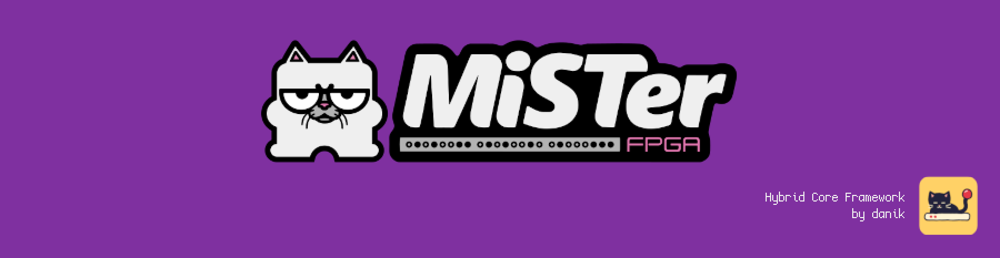

# Hybrid ports for MiSTer

**Hybrid ports** bring PC games to [MiSTer FPGA](https://github.com/MiSTer-devel/Main_MiSTer/wiki) through open source ports of their engines: the game runs on the MiSTer's ARM CPU, and a small FPGA core of its own gives it native 15kHz video for a CRT (and VGA and HDMI), sound and the MiSTer's controllers. Each game gets a menu entry under *Other* and is loaded like any core. They are all built on the same framework, the **Hybrid Core Framework**, so they look, start and play alike. Bring your own game files: none are included.

> **Beta.** Expect rough edges and please report problems in the issues.
>
> **Disclaimer:** AI is being extensively used to speed up development, but the project is well-maintained and supported.

**Installing** (with `update_all`):

1. Copy [`downloader_danik_hybrid_ports.ini`](https://raw.githubusercontent.com/ItsDanik/Hybrid_MiSTer/main/launcher/downloader_danik_hybrid_ports.ini) to the root of your SD card (`/media/fat`).
2. Run `update_all`. It installs the launcher, **danik_hybrid_ports**, in `Scripts`.
3. Run **danik_hybrid_ports** from the `Scripts` menu, tick the games you want and press *X: Apply*.
4. Copy everything in your game's folder to `/media/fat/games/dnk/<Port>/` (or the same folder on a USB drive). The port's page below says which files.
5. Load the game from the *Other* menu, e.g. **dnk-Doom**. The launcher can move the games into a *Hybrid Ports* folder, in *Other* or in the main menu, if you prefer.

## The ports

<!-- ports: tools/make_overview.py -->
<table>
<tr><th align="left">Port</th><th>Framework</th><th>Logo</th><th>Screenshots</th></tr>
<tr>
<td width="190"><a href="https://github.com/ItsDanik/ChocolateQuake_MiSTer"><b>ChocolateQuake</b></a> Quake, Quake - Scourge of Armagon, Quake - Dissolution of Eternity</td>
<td width="90" align="center">v18</td>
<td width="192" align="center">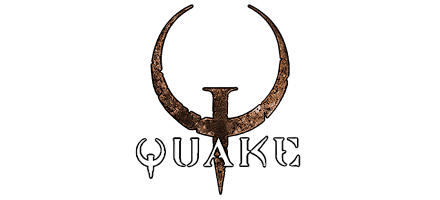</td>
<td width="376" align="center">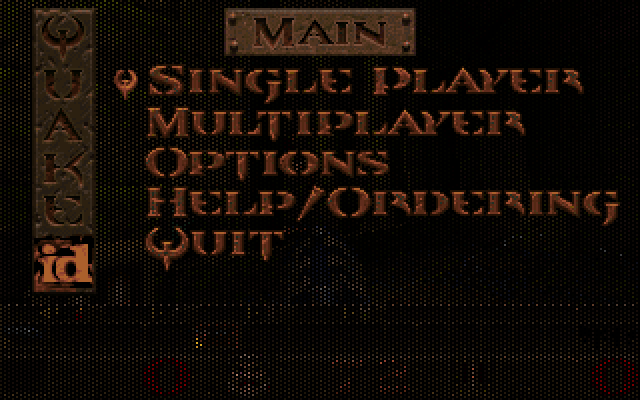 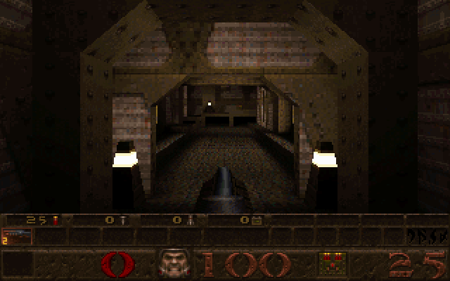</td>
</tr>
<tr>
<td width="190"><a href="https://github.com/ItsDanik/CrispyDoom_MiSTer"><b>CrispyDoom</b></a> Doom, Doom - SIGIL, Doom - SIGIL II, Doom II, Doom II - No Rest for the Living, Doom II - Master Levels, Final Doom - TNT Evilution, Final Doom - Plutonia Experiment, Heretic, Hexen, Hexen - Deathkings, Strife</td>
<td width="90" align="center">v18</td>
<td width="192" align="center">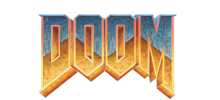</td>
<td width="376" align="center"> </td>
</tr>
<tr>
<td width="190"><a href="https://github.com/ItsDanik/Dethrace_MiSTer"><b>Dethrace</b></a> Carmageddon, Carmageddon: Splat Pack</td>
<td width="90" align="center">v18</td>
<td width="192" align="center">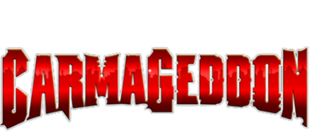</td>
<td width="376" align="center"> 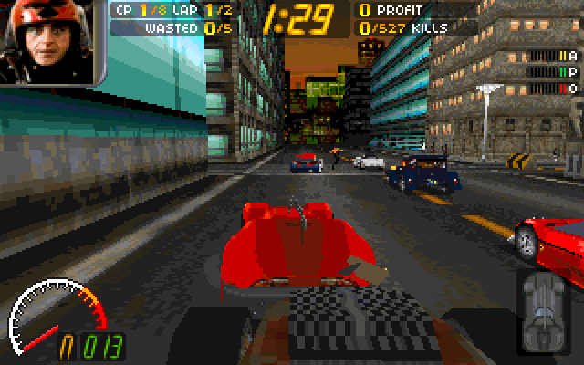</td>
</tr>
<tr>
<td width="190"><a href="https://github.com/ItsDanik/DXXRebirth_MiSTer"><b>DXXRebirth</b></a> Descent, Descent II</td>
<td width="90" align="center">v18</td>
<td width="192" align="center">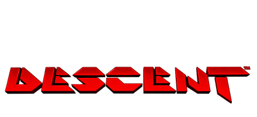</td>
<td width="376" align="center"> </td>
</tr>
<tr>
<td width="190"><a href="https://github.com/ItsDanik/ecwolf_MiSTer"><b>ECWolf</b></a> Wolfenstein 3D, Spear of Destiny, SoD: Return to Danger, SoD: Ultimate Challenge</td>
<td width="90" align="center">v18</td>
<td width="192" align="center">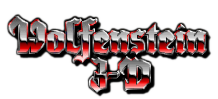</td>
<td width="376" align="center">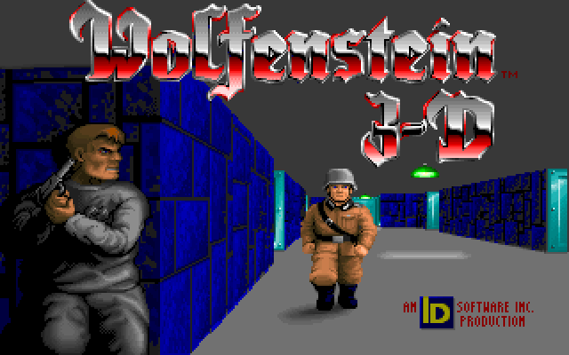 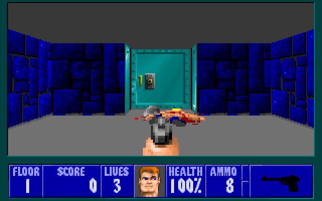</td>
</tr>
<tr>
<td width="190"><a href="https://github.com/ItsDanik/EDuke32_MiSTer"><b>EDuke32</b></a> Duke Nukem 3D, DN3D: Duke It Out in D.C., DN3D: Life&#x27;s a Beach, DN3D: Nuclear Winter, DN3D: Duke!ZONE II, DN3D: Penthouse Paradise</td>
<td width="90" align="center">v18</td>
<td width="192" align="center">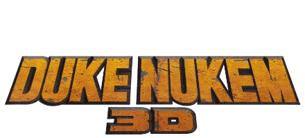</td>
<td width="376" align="center">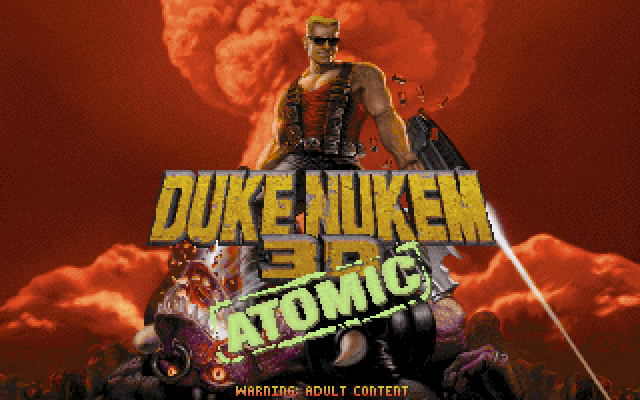 </td>
</tr>
<tr>
<td width="190"><a href="https://github.com/ItsDanik/jfSW_MiSTer"><b>jfSW</b></a> Shadow Warrior, SW: Wanton Destruction, SW: Twin Dragon</td>
<td width="90" align="center">v18</td>
<td width="192" align="center">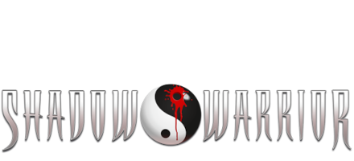</td>
<td width="376" align="center">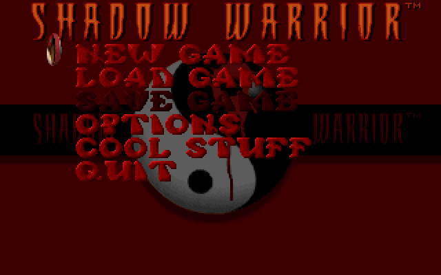 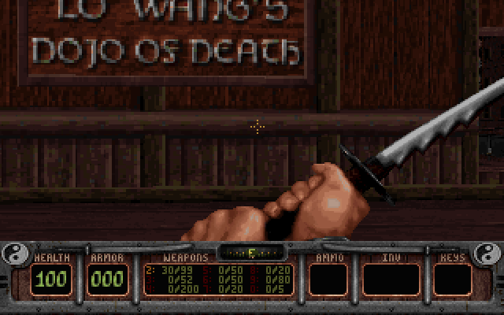</td>
</tr>
<tr>
<td width="190"><a href="https://github.com/ItsDanik/MIDIPlayer_MiSTer"><b>MIDIPlayer</b></a> MIDI Player</td>
<td width="90" align="center">v18</td>
<td width="192" align="center">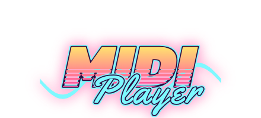</td>
<td width="376" align="center"> </td>
</tr>
<tr>
<td width="190"><a href="https://github.com/ItsDanik/openscreamer_MiSTer"><b>OpenScreamer</b></a> Screamer, Screamer 2</td>
<td width="90" align="center">v18</td>
<td width="192" align="center">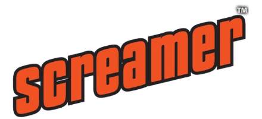</td>
<td width="376" align="center">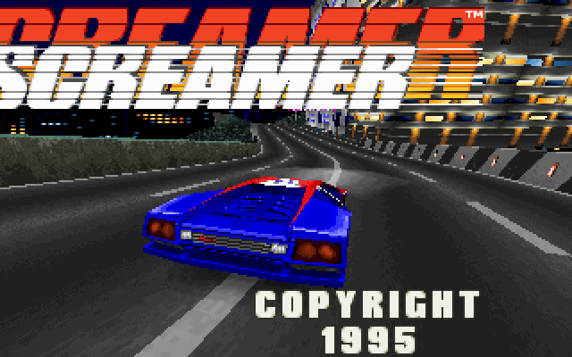 </td>
</tr>
<tr>
<td width="190"><a href="https://github.com/ItsDanik/ReNFS_MiSTer"><b>ReNFS</b></a> Need for Speed SE</td>
<td width="90" align="center">v18</td>
<td width="192" align="center">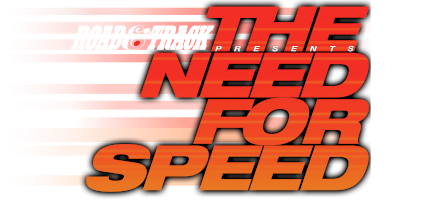</td>
<td width="376" align="center"> </td>
</tr>
<tr>
<td width="190"><a href="https://github.com/ItsDanik/ScummVM_MiSTer"><b>ScummVM</b></a> ScummVM</td>
<td width="90" align="center">v18</td>
<td width="192" align="center">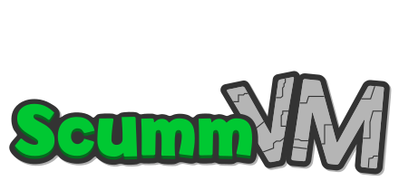</td>
<td width="376" align="center">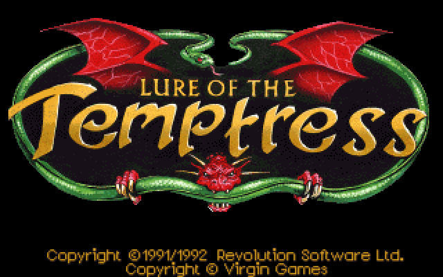 </td>
</tr>
<tr>
<td width="190"><a href="https://github.com/ItsDanik/TheForceEngine_MiSTer"><b>TheForceEngine</b></a> Dark Forces</td>
<td width="90" align="center">v18</td>
<td width="192" align="center">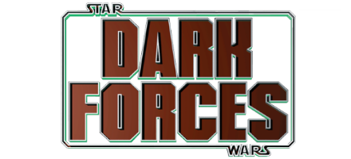</td>
<td width="376" align="center">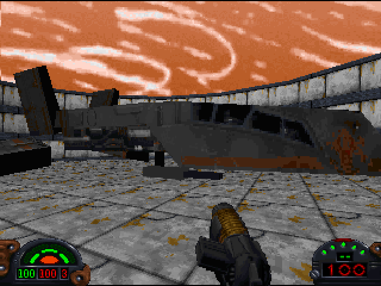 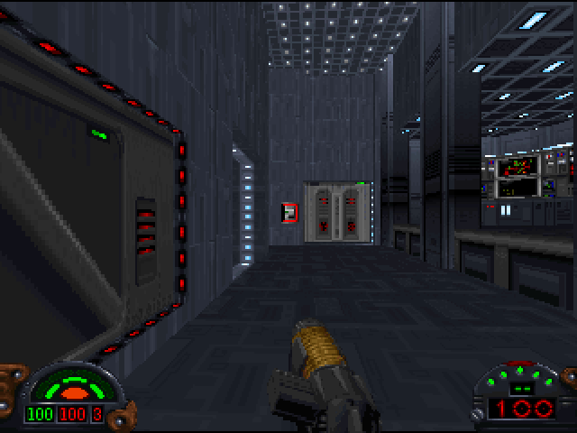</td>
</tr>
<tr>
<td width="190"><a href="https://github.com/ItsDanik/Xash3D_MiSTer"><b>Xash3D</b></a> Half-Life, HL: Opposing Force, HL: Blue Shift</td>
<td width="90" align="center">v18</td>
<td width="192" align="center">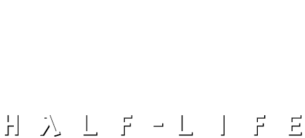</td>
<td width="376" align="center"> 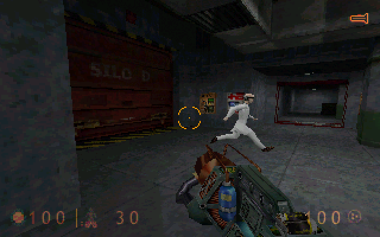</td>
</tr>
<tr>
<td width="190"><a href="https://github.com/ItsDanik/YQuake2_MiSTer"><b>YQuake2</b></a> Quake II, Q2: The Reckoning, Q2: Ground Zero</td>
<td width="90" align="center">v18</td>
<td width="192" align="center">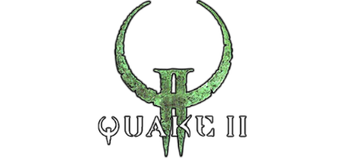</td>
<td width="376" align="center">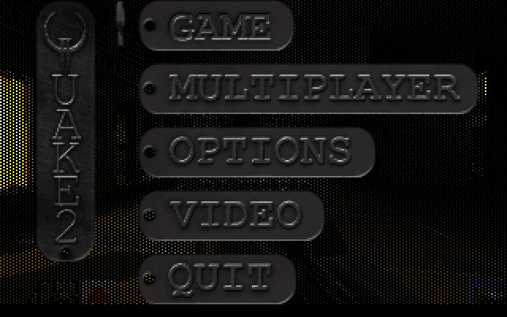 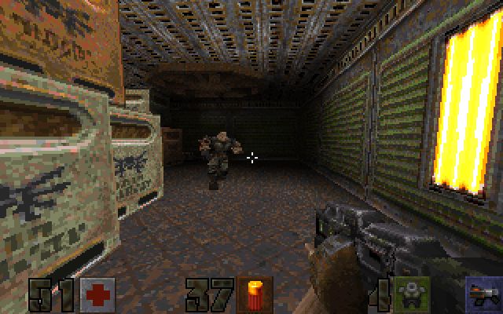</td>
</tr>
</table>
<!-- end of ports -->

## What every port has

### Video

- Native 15kHz RGB for a CRT, 31kHz for a VGA monitor, and HDMI: 320x200, 640x200, 320x240 and 640x240, and 640x400 / 640x480 (interlaced at 15kHz, progressive with *HDMI Only* or `forced_scandoubler=1`). A 15kHz screen never gets more than 15kHz.
- One frame for every field of the screen at 59.6Hz, timed by the core itself, for smooth motion.
- 8-bit palettes done in the FPGA, so palette fades and flashes cost nothing.
- *CRT Options*: the picture's width and position, adjusted for your screen without touching the pixels.
- A *Flicker Filter* for interlaced pictures (Light, Strong or Off), done in the FPGA: fine lines no longer blink at 480i.
- Menus at 480i move at 60 pictures a second on a CRT, not 30.
- 240-line modes where the game allows them: the view fills the whole screen, and *HUD (Top)* / *HUD (Bottom)* move the HUD out of your CRT's overscan, live while you watch.
- *FPS Counter* in the OSD.

### Sound and music

- 44.1kHz stereo with *Stereo Mix*.
- An FM chip in the FPGA (YM3812 / OPL2, the AdLib's), tuned against the real chip, for games whose music was made for one.
- A MIDI synthesizer in the FPGA for games with General MIDI music: 128 voices playing SoundFonts, with reverb and chorus. GeneralUser GS comes with it; up to seven SoundFonts of your own can be picked in the OSD (and in the **MIDI Player** port).
- [MT32-pi](https://github.com/dwhinham/mt32-pi) on the user port: found by itself, with its synth, ROM and SoundFont in the OSD.

### Controls

- Keyboard, mouse and up to two gamepads with both analog sticks, **analog triggers**, stick clicks (L3 / R3) and **rumble**.
- Racing wheels (Logitech G25, G27, G29, Driving Force and others, Fanatec, Thrustmaster): steering with analog gas and brake pedals.
- Menus confirm and go back with your MiSTer's own *Menu OK* / *Menu Back* buttons, and nothing reaches the game while the OSD is open.
- Button mappings and OSD settings are kept per game.
- Cheats in the OSD (*Cheats* page), including the ones you would otherwise have to type.

### Starting and playing

- Every game starts the same way: the core's screen, the check of the game files, the game's logo, the game.
- A port with several games (episodes, expansions) has a menu entry for each; loaded by itself, the core lists the games it finds.
- Missing files are said on screen: which files, for which game and where they go.
- Game files can be on the SD card or on a USB drive.
- [tty2oled+](https://github.com/ItsDanik/MiSTer-tty2oled-plus) OLED display: each game's logo, then its details, description and icon, also for a game picked from a port's list; the Hybrid Core Framework's banner while the list is up.
- The MiSTer's USER button and the OSD's *Reset* start the game again from its beginning, as in every other core.
- *Save Diagnostic Report* in the OSD: if something is wrong, it saves the last 60 seconds of what the game did, to attach to a bug report. Nothing in it identifies you or your network.

### Installing and updating

- Through `update_all`, from the [dnk_Distribution_MiSTer](https://github.com/ItsDanik/dnk_Distribution_MiSTer) database.
- The **danik_hybrid_ports** launcher: run it once and it starts each game whenever its menu entry is loaded; its screen (gamepad, keyboard or mouse) picks which ports and games to have and keeps them up to date.

### For developers

- SDL2 drivers for the framework, so an SDL2 game needs little more than a new build; a C library (`hps/`) for games without SDL.
- A template for new ports (`new_core.sh`), a stand-in for the FPGA core on the PC (`tools/fakecore.c`) and testbenches for the FPGA side. See the [README](README.md).

## Credits and thanks

- **[MiSTer](https://github.com/MiSTer-devel)** by Sorgelig and the MiSTer-devel contributors: the platform and framework every core is built on.
- **[MiSTer Frontier](https://github.com/MiSTerOrganize/MiSTer_Frontier)** by MiSTer Organize: thank you for the inspiration. Hybrid cores on the MiSTer, and the way their games are launched, are inspired by it.
- The authors of every source port the games run on: each port's page names them.
- **[SDL](https://libsdl.org)** by Sam Lantinga and contributors.
- **[JTOPL](https://github.com/jotego/jtopl)** by Jose Tejada (jotego): the FM chip, and **[Nuked OPL3](https://github.com/nukeykt/Nuked-OPL3)** by Nuke.YKT, what it was tuned against.
- **[FluidSynth](https://www.fluidsynth.org)**, whose voices, reverb and chorus the MIDI synthesizer follows, and **[GeneralUser GS](https://www.schristiancollins.com/generaluser.php)** by S. Christian Collins, the SoundFont that comes with it.
- **[MT32-pi](https://github.com/dwhinham/mt32-pi)** by Dale Whinham.
- **[Cozette](https://github.com/slavfox/Cozette)** by slavfox, the font of the core's screen.
- Everyone who tested the ports and reported problems.

Problems and ideas go in the issues of each port's repository.

If you like the ports, become a free member on **[Patreon](https://www.patreon.com/itsdanik)** to get all the latest news and updates.
